# pDAI Names launch film: storyboard v1

*16 November 2026. For review before anything is rendered. The same storyboard as a page, with a motion sketch of
the logo forming: [`storyboard/index.html`](storyboard/index.html).*

A 51-second film for Pulse believers, cut to Skeler's remix of "Clubbed to Death", the music of the first scene of
*The pDAI Mystery* (S0 "Somebody", on `consolidated-research` in pdai-research). The song's intro carries S0's
montage. On the drop, Richard Heart's PulseChain Train comes back, stops at the tunnel, and its outline becomes the
mark. Then the name, the price and the link.

- **Format:** 1920 × 1080, 30 fps, about 51 s. On-screen text and music, no voice-over.
- **Timing:** the track is 95 bpm, so a bar is 2.526 s and a beat 0.632 s. Bar 1 starts at 0.056 s and the drop
  (bar 12) lands at 27.845 s, as in `video/film/src/S0/ext_montage.py`. The film runs to the downbeat of bar 20
  (48.06 s) and a three-second echo tail.
- **Look:** pDAI Name Service's own: navy `#08071A`, pDAI's five-stop gradient, white type in Space Grotesk. From the
  references: an aurora glow along the bottom, glass UI cards, one word in colour per line, a line that draws itself
  into the logo, and one idea per beat.

| Bars | Time | Part |
|---|---|---|
| 1–2 | 0:00.0 – 0:05.1 | Open |
| 3–11 | 0:05.1 – 0:27.8 | S0's montage, embedded |
| 12–15 | 0:27.8 – 0:37.9 | The train becomes the mark |
| 16–19 | 0:37.9 – 0:48.1 | The product |
| 20 + tail | 0:48.1 – 0:51.1 | Lockup |

## How the mark forms

The loop is the train: its roof, its rounded nose and its floor. The bowl is the tunnel's arch, turned 90° to face it.
The brand calls the mark Echo (`brand/README.md`): a name goes into the tunnel and its address comes back. Shots 04–09
show it, using the GIF from Heart's post of 14 Aug 2025 ("The PulseChain Train is coming to town…",
`video/assets/tweets/x-media/1955656233643577809_rh-pulsechain-train.mp4`).

- The traced lines follow the cartoon's real outlines, from the frame where the nose meets the tunnel (the GIF at
  4.00 s, mirrored so the train runs left to right).
- They snap to the brand's 64-unit grid and become the exact mark: 6 units thick, round ends, gaps of 7.21, 5.77 and
  7.21.
- The same shape is Dai's Đ with its upright taken away and its two lines joined into a loop. The coin's Đ lines up
  with the mark almost exactly: its strikes sit at 24.3–29.4 and 34.8–40.0 on the grid, the loop's lines at
  23.1–29.1 and 34.9–40.9. That is the optional beat in shot 09.

## Shots

Amber text and dashed arrows in the frames are direction notes, never on screen.

### 01 · Open · bars 1–2 · 0:00.0 – 0:05.1


- **On screen:** "Pulse believers," then "you were here for all of it."
- **Picture:** navy; the gradient glows low along the bottom and breathes with the music. Line one lands on bar 1,
  line two on bar 2. On the last beat the type pushes toward the camera into the first montage shot.
- **Sound:** the track from its first note.

### 02 · The montage · bars 3–10 · 0:05.1 – 0:25.3 · one beat changed

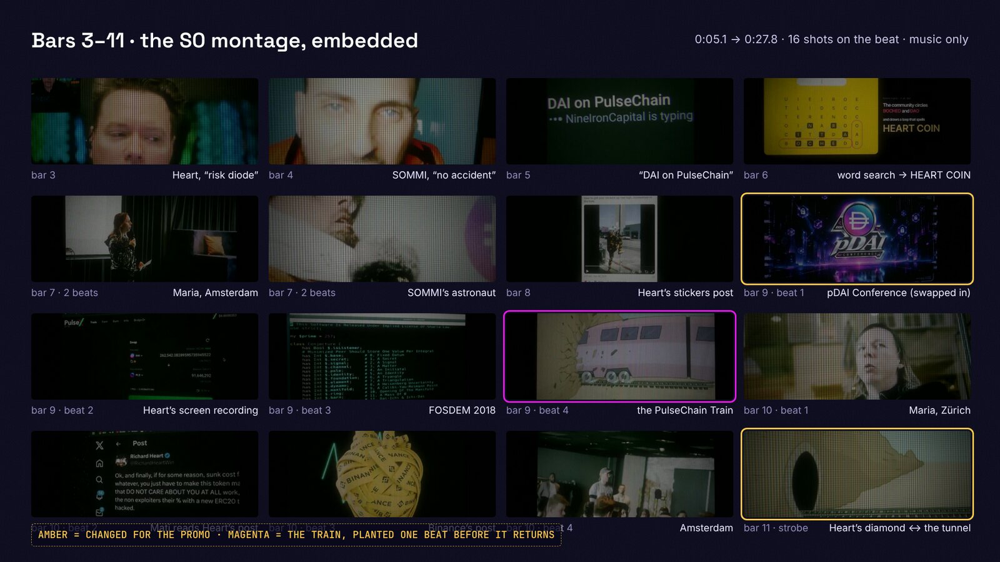

- **On screen:** nothing added.
- **Picture:** S0's montage frame for frame: 15 shots on angled screens with an RGB pixel grid. One change: bar 9,
  beat 1 was StoryTeller's post naming a person as the exploiter, with his photo. Here it is the pDAI Conference art
  (`video/assets/community/pdai-conference/conference-cyber-city.jpg`) in the same screen treatment. The
  PulseChain Train flashes past on bar 9, beat 4, one bar before it comes back.
- **Sound:** the track, bars 3–10, as in the film.

### 03 · The breath · bar 11 · 0:25.3 – 0:27.8 · new

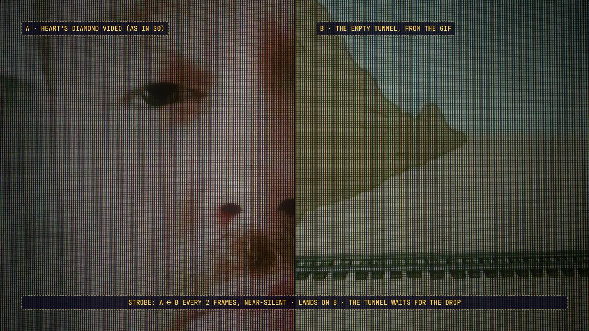

- **On screen:** nothing.
- **Picture:** S0's strobe on Heart's diamond video now flickers with the empty tunnel from the GIF (its frame at
  0.80 s), two frames each, and lands on the tunnel.
- **Sound:** the track's near-silent bar.

### 04 · The drop · bar 12, beats 1–2 · 0:27.8 – 0:29.1

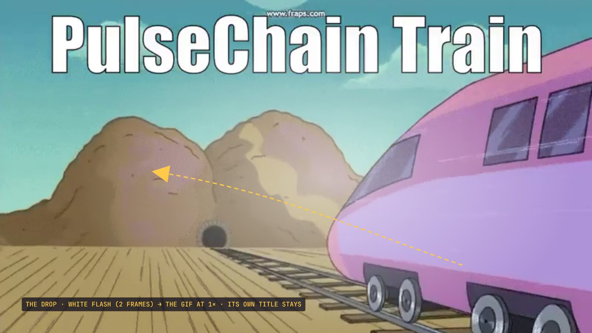

- **On screen:** the GIF's own "PulseChain Train" title.
- **Picture:** a two-frame white flash, then the GIF at full speed: the train charging the tunnel, three-quarter on.
- **Sound:** the drop; a whoosh with the train.

### 05 · Freeze · bar 12, beats 3–4 · 0:29.1 – 0:30.4

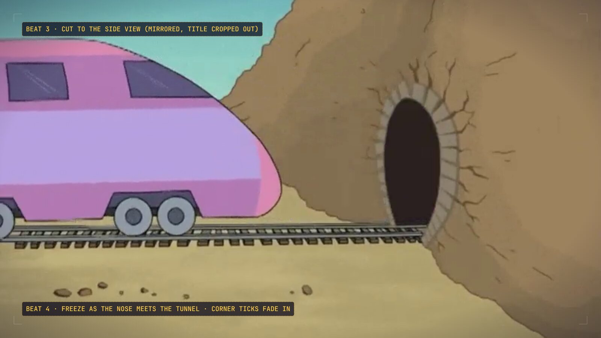

- **On screen:** nothing.
- **Picture:** cut to the side view, mirrored, title cropped out. The nose closes on the tunnel and the frame freezes
  on beat 4. Hairline corner ticks fade in.
- **Sound:** a shutter click on the freeze.

### 06 · Trace · bar 13 · 0:30.4 – 0:32.9

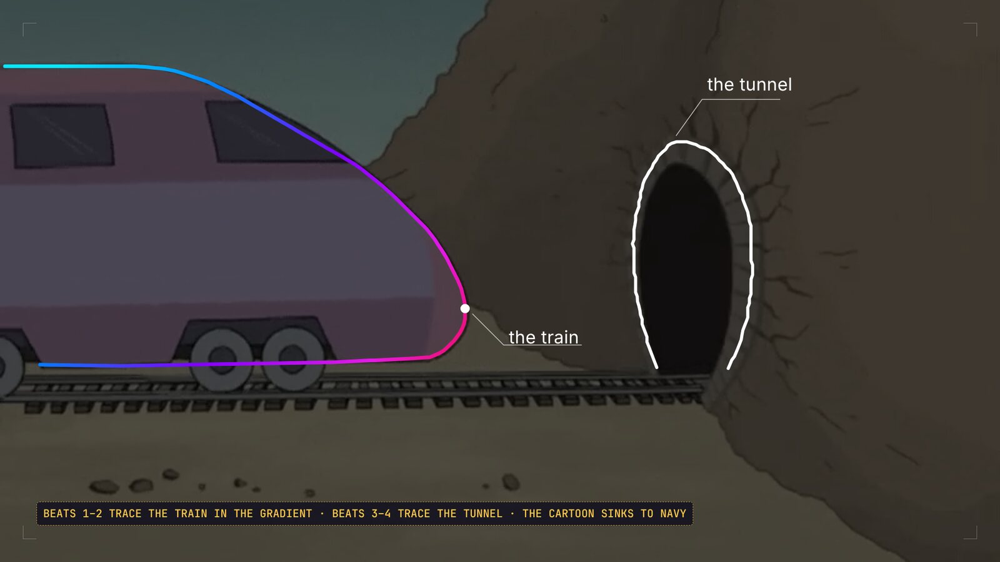

- **On screen:** "the train", "the tunnel".
- **Picture:** a line in the gradient traces the train's roof, nose and floor (beats 1–2); a white line traces the
  tunnel's arch (beats 3–4). The cartoon sinks into the navy.
- **Sound:** a soft shimmer under each line.

### 07 · Construction · bar 14, beats 1–2 · 0:32.9 – 0:34.2

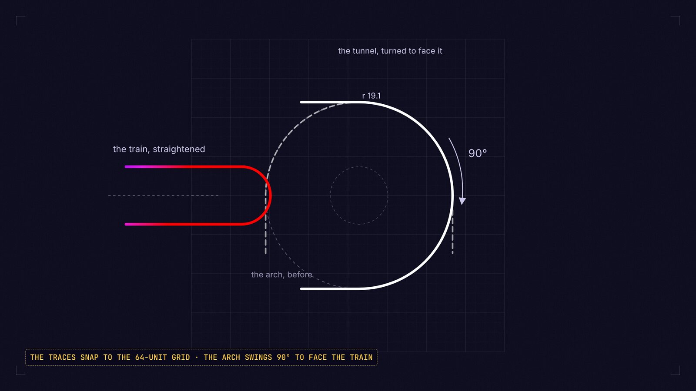

- **On screen:** "r 19.1", "90°".
- **Picture:** the 64-unit grid fades in. The train's line straightens into the loop. The arch swings 90° to face it
  and opens out into the bowl.
- **Sound:** grid ticks.

### 08 · Lock · bar 14, beats 3–4 · 0:34.2 – 0:35.4

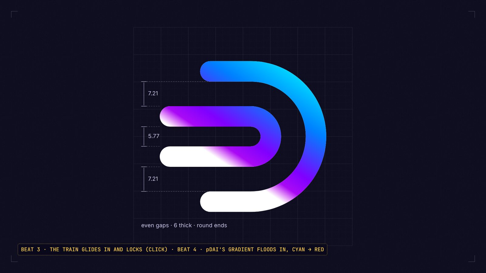

- **On screen:** "7.21", "5.77", "7.21".
- **Picture:** the train glides into the tunnel and locks. The lines swell to full weight with round ends, the gaps
  are measured, and the gradient floods in from cyan to red.
- **Sound:** a click on beat 3, a swell into beat 4.

### 09 · Echo · bar 15 · 0:35.4 – 0:37.9 · optional beat

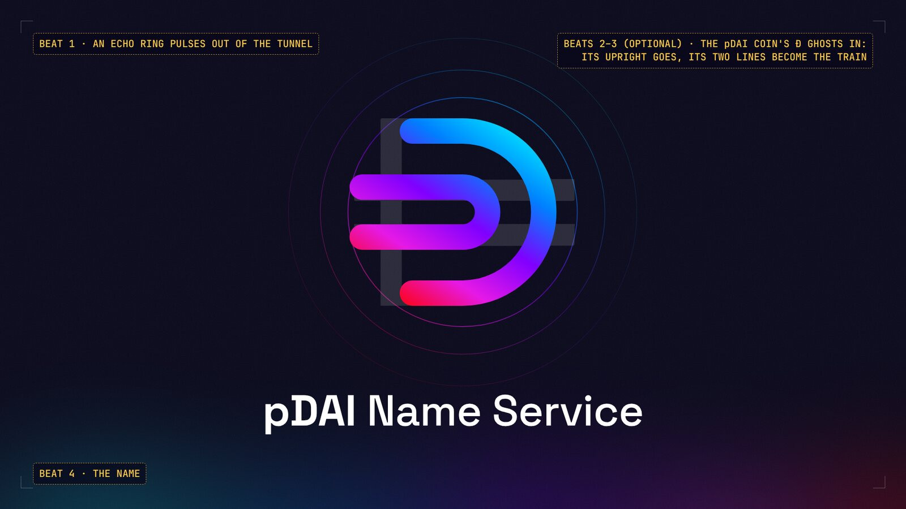

- **On screen:** "pDAI Name Service".
- **Picture:** an echo ring pulses out of the tunnel. Optional: the pDAI coin's Đ ghosts in behind the mark, its
  upright drops away, and its two lines are the train. The name sets on beat 4.
- **Sound:** a ping with a long echo.

### 10 · Next stop · bar 16 · 0:37.9 – 0:40.5

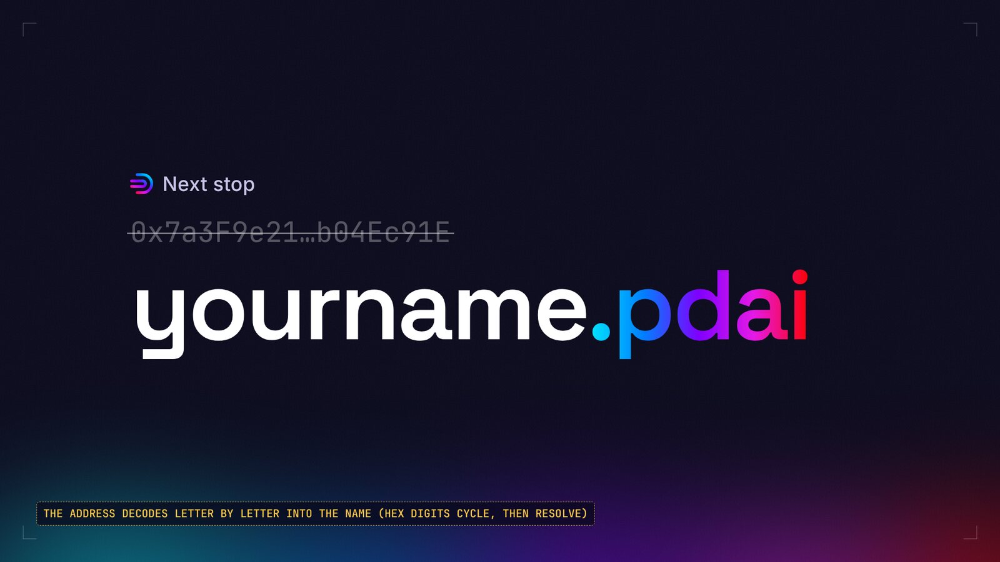

- **On screen:** "Next stop", "0x7a3F9e21…b04Ec91E", "yourname.pdai".
- **Picture:** a wallet address decodes letter by letter into the name; ".pdai" resolves in the gradient.
- **Sound:** hex ticks as it decodes.

### 11 · Pay · bar 17 · 0:40.5 – 0:43.0

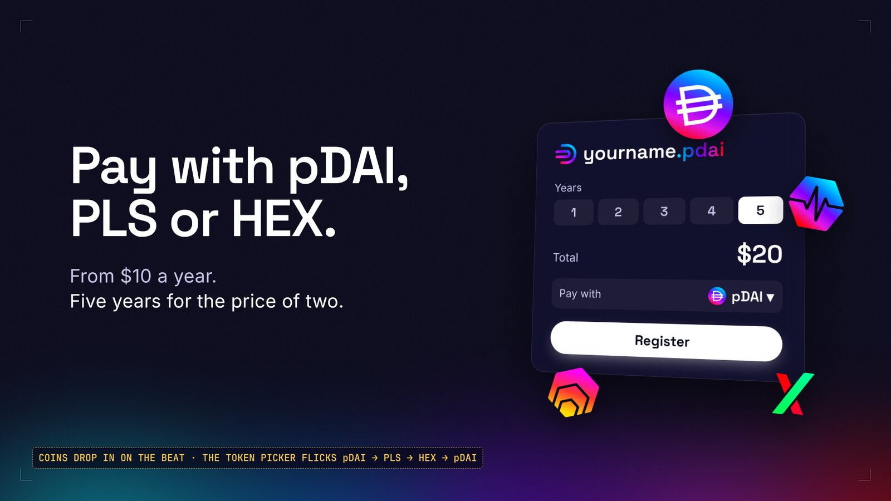

- **On screen:** "Pay with pDAI, PLS or HEX." "From $10 a year. Five years for the price of two."
- **Picture:** a glass checkout card for yourname.pdai, 5 years, $20. pDAI, PLS, HEX and PLSX coins drop in on the
  beats while the token picker flicks through them.
- **Sound:** a coin clink per beat.

### 12 · Yours · bar 18 · 0:43.0 – 0:45.5

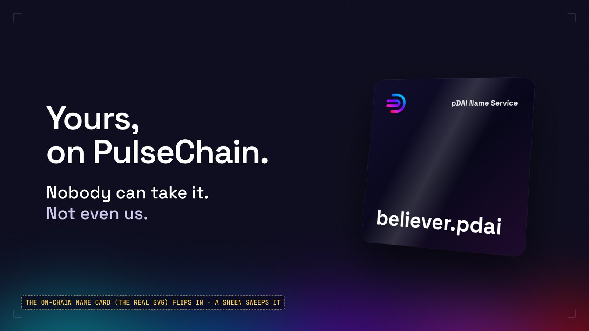

- **On screen:** "Yours, on PulseChain." "Nobody can take it. Not even us."
- **Picture:** the name's card flips in, the same SVG `PdaiNameCard` draws on-chain. A sheen sweeps across it.
- **Sound:** a card whoosh.

### 13 · Find yours · bar 19 · 0:45.5 – 0:48.1


- **On screen:** "Find yours." In the search: "believer.pdai".
- **Picture:** the site's featured names (`web/src/data/featured.ts`, each reserved for its owner) drift in around
  the search bar, and a name types itself.
- **Sound:** key taps.

### 14 · Lockup · bar 20 + tail · 0:48.1 – 0:51.1


- **On screen:** the mark and "pDAI Name Service", "Your .pdai name on PulseChain", "pdai.domains", "Live now on
  PulseChain · Built on ENSv2".
- **Picture:** the lockup on navy with faint echo rings. Hold, then black.
- **Sound:** the downbeat of bar 20, then the music cuts to a delay tail that echoes out over about three seconds.

## The words on screen

| Shot | Text |
|---|---|
| 01 | Pulse believers, / you were here for all of it. |
| 06 | the train · the tunnel |
| 07–08 | r 19.1 · 90° · 7.21 · 5.77 · 7.21 |
| 09 | pDAI Name Service |
| 10 | Next stop · yourname.pdai |
| 11 | Pay with pDAI, PLS or HEX. / From $10 a year. Five years for the price of two. |
| 12 | Yours, on PulseChain. / Nobody can take it. Not even us. |
| 13 | Find yours. / believer.pdai |
| 14 | pDAI Name Service / Your .pdai name on PulseChain / pdai.domains / Live now on PulseChain · Built on ENSv2 |

Each claim is from this repo's README: $10 a year for 5 or more characters and 5 years for $20; the app takes pDAI,
PLS, HEX, eHEX and PLSX among others; nobody, the admin and the deployer included, can unregister, move or redirect a
live name. Nothing on screen says audited or secure, since the README still lists the contracts as unaudited.

## Open before rendering

1. **The track file.** The repo has the song only inside `video/film/S0_Somebody.mp4`. Its stems are silent until the
   drop, so up to 0:27.83 the film's audio is music only, but after it the music sits under Heart's voice. The render
   needs the bought MP3 or WAV (what S0's build reads as `S0_MUSIC`), and its licence should cover a promo for pDAI
   Names as well as the film.
2. **The bar 9 swap.** Recommended: in an ad the StoryTeller post would run without the film's "Claim" stamp and read
   as the ad accusing a named person.
3. **Bar 11.** Intercut the empty tunnel with S0's strobe (as boarded) or keep S0's strobe untouched.
4. **The Đ beat in shot 09.** Keep or drop; it costs no time.
5. **A credit on the montage.** A small "From The pDAI Mystery" tag marks it as an excerpt from the film, so the
   people in it don't read as endorsing pDAI Names. Recommended if the film is public or about to be.
6. **The end card's link.** The README lists the domain under "Not done yet". Confirm `pdai.domains` is live.
7. **Example names.** `yourname.pdai` and `believer.pdai`, or any others.

## How it gets made

- The montage is re-rendered by S0's own `ext_montage.py` with the one swap and the new bar 11, so the rest matches the
  film frame for frame.
- Shots 04–14 are HTML and SVG scenes rendered frame by frame at 30 fps with Playwright, as S0 was. The mark is drawn
  from `MARK_PATH`, the path the site and the name cards share.
- Sound: the track plus a few synthesized effects (whoosh, click, ping, ticks), mixed to about −16 LUFS like the film.
- The master is 1920 × 1080 H.264 with AAC; vertical and square cuts can follow.

## Rebuilding this storyboard

```bash
promo/storyboard/src/build.sh /tmp/storyboard-work
```

It needs ffmpeg, ImageMagick, Python 3, Node with Playwright, this repo, and pdai-research on `consolidated-research`
with the S0 film, the train GIF, the pDAI Conference art and `token logos/` checked out (paths in `PDAI_NAMES` and
`PDAI_REPO`). It writes `site/`, the page and its frames; copy it over `promo/storyboard/` (the page as `index.html`).
